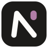
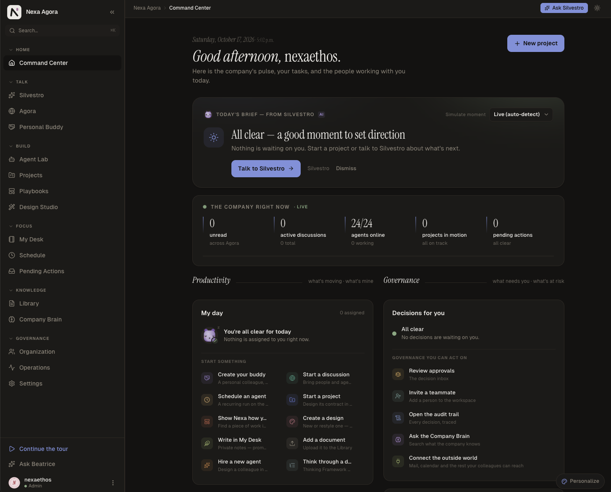
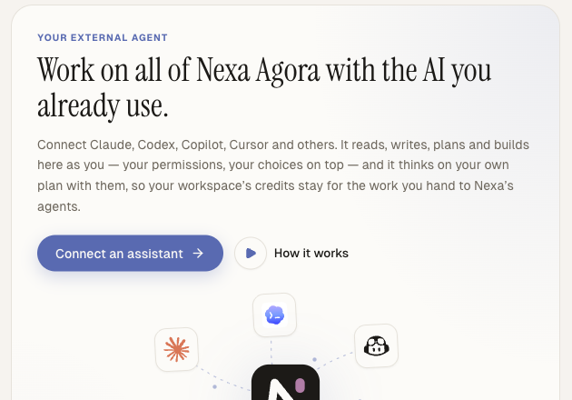
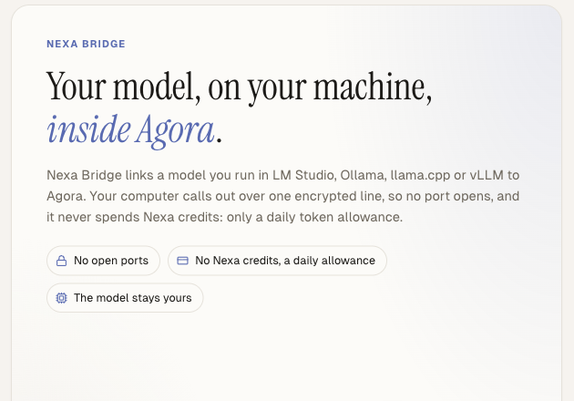
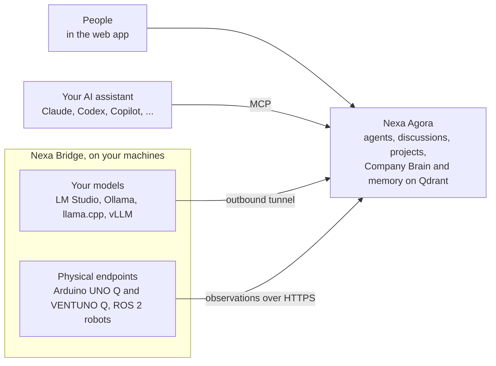

  

<h1 align="center">Nexa Agora</h1>

  <b>The workspace where people and AI agents run the company together.</b>

  <a href="https://agora.nexaethos.com">Website</a> ·
  <a href="docs/mcp/README.md">Connect your assistant</a> ·
  <a href="https://github.com/NexaEthos/nexa-bridge">Nexa Bridge</a>

  On the web and on iPhone, with the Nexa Agora iOS app. Android is coming soon.

  
  
  
  
  

  

Nexa Agora gives a company a team of AI agents with real roles — research, project management, design, data,
documentation — that work in the open with the people they serve. Discussions, projects, playbooks and documents live
in one place, the Company Brain keeps what the company learns, and **people approve before agents act**.

## Governed by design, not prompt and pray

Many agent products write a careful prompt and hope the model behaves. In Nexa Agora **the model proposes and the
platform decides**: isolation, permissions, approvals and checks are enforced by the database and the server, so they
hold when a model is wrong, confused or manipulated.

<table>
  <tr>
    <td width="50%" valign="top">
      <b>Isolation in the database.</b> Every workspace table carries PostgreSQL row-level security that fails
      closed, and every search of the Qdrant vector store carries the workspace's partition; the server refuses
      to start if a table escapes its policy, and the application cannot bypass it.
    </td>
    <td width="50%" valign="top">
      <b>Roles, not goodwill.</b> Owner, admin, member. An agent never holds more than its person, platform powers
      can never be granted to a customer, and a Private document stays private even to admins.
    </td>
  </tr>
  <tr>
    <td width="50%" valign="top">
      <b>People approve before agents act.</b> Emails, deletions, memory changes and code changes wait for a
      person's approval, and the email that leaves is byte for byte the one approved.
    </td>
    <td width="50%" valign="top">
      <b>Checks a prompt cannot skip.</b> A reviewer other than the author judges every deliverable, and what it
      could not confirm is declared with it; citations must point to real sources, models come only from the
      workspace's policy, and spending meets a credit wall.
    </td>
  </tr>
  <tr>
    <td width="50%" valign="top">
      <b>Every step on the record.</b> A tamper-evident audit log, hash-chained per workspace and verifiable on
      demand, plus a trace of every agent turn.
    </td>
    <td width="50%" valign="top">
      <b>GDPR and the EU AI Act, built in.</b> Hosted in the EU, export and erasure on request, retention enforced
      in code, AI output marked in machine-readable form (AI Act article 50).
    </td>
  </tr>
</table>

**[How Nexa Agora keeps agents governed](docs/trust.md)**

## Bring the AI you already use

Claude, Claude Code, Codex, GitHub Copilot, Cursor, Antigravity, Grok Build, Mistral Vibe, Gemini CLI and Hermes
Agent connect to your workspace through MCP. Your assistant works there as you, with your permissions and your
choices, and it reasons on your own plan, so the workspace's credits stay for the work you hand to Nexa's agents.

1. In the [web app](https://agora.nexaethos.com), open **Settings › Your external agent** and pick your assistant.
2. Follow the steps it shows: your server address and client ID are already filled in.
3. Give your assistant [its instructions](docs/mcp/assistant-instructions.md) and run the read-only check.

**[Read the guide](docs/mcp/README.md)**

 

## Nexa Bridge: your machines, and the physical world

[Nexa Bridge](https://github.com/NexaEthos/nexa-bridge) is open source and connects your own machines to a
workspace. Every connection it opens is outbound: no public address, no port forwarding, no inbound firewall rule.

- **Your own models.** An OpenAI-compatible proxy in front of a local model server (vLLM, Ollama, LM Studio,
  llama.cpp); the workspace then uses that model like any other. A desktop app pairs the computer from the browser.
- **Physical endpoints (preview).** A lab board or a ROS 2 robot pairs with the workspace on its own credential,
  approved by an owner or admin, and sends observations over HTTPS: telemetry summaries, state changes,
  diagnostics and alerts. Observation only: the device takes no commands. Today's adapters read an Arduino Q board's
  system state (accepted on the UNO Q, with the VENTUNO Q in acceptance in our lab) and a ROS 2 robot's battery, on
  Linux and macOS.

 

### Where it is going: Physical AI

The bridge is how Nexa Agora reaches beyond the screen. We are developing it to connect Agora's orchestration — its
agents, projects, playbooks and approvals — with the machines a company runs: lab boards, robots, production lines.
It is our bridge to **Physical AI**: agents that understand what the physical world reports and, with a person's
approval, act on it. Advancing in that world is one of our priorities. Today the bridge observes; every step beyond
observation will come with explicit grants and human approval.

⭐ **Star this repository to follow the Physical AI work.**

## How it fits together

## This repository

- [`docs/mcp/`](docs/mcp/README.md): the guide to connecting your assistant, the supported assistants, the
  instructions to give it, a first piece of work, troubleshooting and the connection contract.
- [`docs/trust.md`](docs/trust.md): security, permissions, approvals, audit, GDPR and the EU AI Act, in technical
  detail.
- [`assets/`](assets): the logo and the product screenshots.

There is nothing to clone or install: everything happens in the web app and in your assistant.

## Licence and security

The guides and examples are released under the [MIT licence](LICENSE). Report a security problem as described in
[SECURITY.md](SECURITY.md), never in a public issue.
